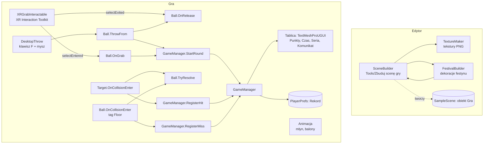

# Strzelnica VR – informacje o projekcie

Gra VR: rzucanie piłkami do tarcz na stanowisku (strzelnicy) na festynie.
Projekt zbudowany na szablonie VR Unity (XR Interaction Toolkit + OpenXR, URP).
Wszystkie dane poniżej pochodzą z kodu i plików projektu (stan na commit `e9de530`).

---

## 1. Wersje

**Unity:** `6000.6.10f1` (revision `40e81493c67d`) – z `ProjectSettings/ProjectVersion.txt`.

**Najważniejsze pakiety** (`Packages/manifest.json`):

| Pakiet | Wersja | Uwagi |
|---|---|---|
| XR Interaction Toolkit (`com.unity.xr.interaction.toolkit`) | 3.6.1 | kopia osadzona w `Packages/com.unity.xr.interaction.toolkit` (źródło `embedded` w `packages-lock.json`) |
| OpenXR (`com.unity.xr.openxr`) | 1.18.0 | |
| Meta OpenXR (`com.unity.xr.meta-openxr`) | 2.6.1 | |
| Android XR OpenXR (`com.unity.xr.androidxr-openxr`) | 1.4.2 | |
| XR Plugin Management (`com.unity.xr.management`) | 4.7.0 | |
| XR Core Utils (`com.unity.xr.core-utils`) | 2.6.0 | |
| XR Hands (`com.unity.xr.hands`) | 1.9.0 | |
| AR Foundation (`com.unity.xr.arfoundation`) | 6.6.2 | z szablonu, gra go nie używa |
| XR Composition Layers (`com.unity.xr.compositionlayers`) | 2.6.1 | z szablonu |
| Universal RP (`com.unity.render-pipelines.universal`) | 17.6.0 | |
| Input System (`com.unity.inputsystem`) | 1.20.1 | |
| TextMeshPro | w `com.unity.ugui` 2.6.0 (builtin) | osobnego pakietu TMP w manifeście brak |
| `com.unity.pipeline` | 1.0.0 | obsługa CLI `unity` (sterowanie edytorem z terminala) |

**Sample XRI w `Assets/Samples/XR Interaction Toolkit/`:**
- 3.5.1: Starter Assets, Hands Interaction Demo;
- 3.6.1: XR Interaction Simulator.

**Render pipeline:** asset `Performance URP Config`, aktywny poziom jakości `Low`, przestrzeń kolorów `Linear`.

**Wejście:** tylko Input System (`UnityEngine.InputSystem` w `DesktopThrow.cs`).

---

## 2. Krótki opis gry

1. Gracz stoi przed ladą stanowiska. Na blacie leżą **4 kolorowe piłki**. Na tablicy widnieje napis „Złap piłkę, aby zacząć!” i aktualny rekord.
2. **Złapanie dowolnej piłki** (kontroler VR, ręka albo symulator) rozpoczyna rundę trwającą **60 s**. Bez gogli rundę rozpoczyna też rzut klawiszem F.
3. Gracz rzuca piłki w tarcze stojące w głębi stanowiska:
   - 4 czerwone tarcze;
   - 1 mniejszą złotą tarczę, która porusza się na boki.
4. Trafiona tarcza znika na 1 s i pojawia się w losowym miejscu w pobliżu. Na tablicy pojawia się liczba zdobytych punktów.
5. Rzucona piłka **po 1,5 s wraca na ladę**. Wraca też od razu, jeśli spadnie poniżej y = -5.
6. Na tablicy na bieżąco widać punkty, pozostały czas i aktualną serię z mnożnikiem.
7. Po upływie 60 s runda się kończy. Na tablicy pojawia się:
   - wynik;
   - celność w %;
   - najdłuższa seria;
   - rekord;
   - napis „Złap piłkę, aby zagrać ponownie”.
8. Złapanie piłki rozpoczyna nową rundę.

---

## 3. Zasady punktacji (wartości z kodu)

| Zasada | Wartość | Gdzie w kodzie |
|---|---|---|
| Zwykła (czerwona) tarcza | **10 pkt** | `SceneBuilder.MakeTarget(..., 10, 0f)`; domyślnie `Target.points = 10` |
| Złota tarcza | **30 pkt** | `SceneBuilder.MakeTarget("Zlota tarcza", ..., 30, 1.5f)` |
| Mnożnik | seria ≥ 3 → **x2**, ≥ 6 → **x3**, ≥ 10 → **x4**, poniżej 3 → x1 | `GameManager.Multiplier()` |
| Naliczanie | `punkty tarczy × mnożnik` (mnożnik liczony już z nową, powiększoną serią) | `GameManager.RegisterHit()` |
| Premia za serię | **+50 pkt** co 5 trafień z rzędu (`streak % 5 == 0`), bez mnożnika | `GameManager.RegisterHit()` |
| Czas rundy | **60 s** (`roundTime = 60f`) | `GameManager` |
| Pudło | piłka dotyka obiektu z tagiem **`Floor`** („Trawa” lub „Deski”), zanim rzut został policzony. Seria spada do 0, a rzut liczy się do liczby rzutów. | `Ball.OnCollisionEnter()`, `GameManager.RegisterMiss()` |
| Jeden wynik na rzut | `Ball.TryResolve()` zwraca `true` tylko raz po każdym rzucie | `Ball` |
| Celność | `trafienia * 100 / rzuty` (dzielenie całkowite, 0 gdy brak rzutów) | `GameManager.EndRound()` |
| Rekord | `PlayerPrefs` pod kluczem **`"Rekord"`**: maksimum ze starego rekordu i wyniku, zapis od razu (`PlayerPrefs.Save()`) | `GameManager.EndRound()` |
| Poza rundą | trafienia i pudła są ignorowane (`if (!roundActive) return;`) | `GameManager` |

**Przykład.** Kolejne trafienia w czerwone tarcze dają:

| Trafienie | Seria | Punkty |
|---|---|---|
| 1. | 1 (x1) | 10 |
| 2. | 2 (x1) | 10 |
| 3. | 3 (x2) | 20 |
| 4. | 4 (x2) | 20 |
| 5. | 5 (x2) | 20 + 50 premii |

---

## 4. Lista skryptów

### Skrypty gry (`Assets/Scripts`)

#### `Assets/Scripts/GameManager.cs` (87 linii)
Zarządza rundą: czas, punkty, seria, mnożnik, rekord i teksty na tablicy.

**Pola public:**
- `static GameManager Instance`;
- `TextMeshProUGUI pointsText, timeText, streakText, messageText`;
- `float roundTime = 60f`;
- `bool roundActive`.

**Pola prywatne:**
- `timeLeft`, `messageTimer`;
- `score`, `streak`, `bestStreak`, `hits`, `throws`.

**Metody:**
- `Awake()` ustawia `Instance`.
- `Start()` wyświetla komunikat startowy z rekordem.
- `Update()` odlicza czas, kończy rundę i chowa komunikat po czasie.
- `StartRound()` (public) nic nie robi, jeśli runda trwa.
- `Multiplier()`.
- `RegisterHit(int points)` (public).
- `RegisterMiss()` (public).
- `EndRound()`.
- `ShowMessage(string, float)`. Czas `0` oznacza, że komunikat zostaje na stałe.
- `UpdateTexts()`.

#### `Assets/Scripts/Ball.cs` (81 linii)
Piłka do rzucania. Pamięta pozycję na ladzie, wraca na nią po rzucie i pilnuje, żeby rzut został policzony tylko raz.

**Wymagane komponenty:** `[RequireComponent(typeof(Rigidbody), typeof(XRGrabInteractable))]`.

**Pola public:** `float returnDelay = 1.5f`.

**Pola prywatne:** `rb`, `grab`, `startPos`, `startRot`, `thrown`, `resolved`, `returnTimer`.

**Metody:**
- `Awake()` podpina `selectEntered` → `OnGrab` i `selectExited` → `OnRelease`.
- `OnGrab()` wywołuje `GameManager.StartRound()`.
- `OnRelease()` rozpoczyna rzut: `thrown = true`, `resolved = false`, start licznika powrotu.
- `ThrowFrom(Vector3 position, Vector3 velocity)` (public) to rzut bez gogli.
- `TryResolve()` (public).
- `Update()` przywraca piłkę na ladę po czasie albo gdy `y < -5`, chyba że piłka jest trzymana.
- `OnCollisionEnter()` obsługuje tag `Floor` → `RegisterMiss()`.

#### `Assets/Scripts/Target.cs` (66 linii)
Tarcza. Po trafieniu chowa się na 1 s i pojawia obok z efektem „wyskoczenia”. Opcjonalnie porusza się na boki.

**Pola public:**
- `int points = 10`;
- `float moveAmplitude = 0f`;
- `float moveSpeed = 1.5f`;
- `float respawnRange = 0.8f`;
- `float hideTime = 1f`.

**Metody:**
- `Start()` zapamiętuje pozycję i skalę oraz pobiera renderery i collider.
- `Update()`:
  - odlicza ukrycie;
  - powiększa tarczę do normalnej skali (`MoveTowards`, 3 jednostki/s);
  - porusza nią sinusoidalnie w lokalnej osi X.
- `OnCollisionEnter()`:
  - jeśli to `Ball` i `TryResolve()`, wywołuje `RegisterHit(points)`;
  - wyłącza renderery i collider.
- `Show()` ustawia nową pozycję: X w zakresie ±0,8, Y w zakresie ±0,4, startowa skala 20%.

#### `Assets/Scripts/DesktopThrow.cs` (43 linie)
Tryb testowy bez gogli: celowanie kursorem myszy i rzut klawiszem **F**.

**Pola public:** `float throwSpeed = 15f`, `float lift = 2f`.

**Metody:**
- `Start()`:
  - zbiera piłki z dzieci obiektu;
  - jeśli brak gogli (`XRSettings.isDeviceActive == false`): ustawia kamerę na 1,6 m, pochyla ją o 9°, ustawia FOV 75 i ukrywa `MeshRenderer` kontrolerów.
- `Update()`:
  - po naciśnięciu F rzuca kolejną piłkę (po kolei 1→4) promieniem z kamery przez kursor;
  - prędkość rzutu to `kierunek × 15 + góra × 2`;
  - start piłki 0,5 m przed kamerą, nie niżej niż y = 1,2.

#### `Assets/Scripts/Animacja.cs` (23 linie)
Animacja dekoracji: obrót i bujanie góra-dół.

**Pola public:**
- `Vector3 rotationSpeed` (stopnie/s);
- `float bobHeight = 0f`;
- `float bobSpeed = 1f`.

**Metody:** `Start()`, `Update()`.

### Skrypty edytora (`Assets/Editor`, nie trafiają do buildu)

#### `Assets/Editor/SceneBuilder.cs` (275 linii)
Menu **`Tools/Zbuduj scenę gry`**: buduje całą grę w otwartej scenie pod obiektem `Gra`.

**Metody public static:**
- `Build()`;
- `Mat(Color, smooth, metal, glow)` – materiał URP/Lit;
- `TexMat(Texture2D, tiling, smooth)`;
- `Make(PrimitiveType, name, parent, pos, scale, mat)`.

**Metody prywatne:** `Bulb`, `MakeLight`, `MakeTarget`, `Ring`, `MakeText`.

#### `Assets/Editor/FestivalBuilder.cs` (261 linii)
Dekoracje festynu wokół stanowiska pod `Gra/Festyn`. Wywoływany z `SceneBuilder.Build()`.

**Metoda public:** `Build(Transform)`.

**Metody prywatne:** `FerrisWheel`, `Teddy`, `Stall`, `Garland`, `Lamp`, `Balloons`, `Prop`, `Beam`, `Unlit`, `Label`.

#### `Assets/Editor/TextureMaker.cs` (112 linii)
Tekstury rysowane w kodzie (512×512, bezszwowe), zapisywane jako PNG w `Assets/Textures`.

**Metody public static:**
- `Planks()` → `Deski.png`;
- `CounterPanel()` → `Lada.png`;
- `Stripes()` → `Paski.png`;
- `Stars()` → `Gwiazdy.png`;
- `Grass()` → `Trawa.png`.

**Metody prywatne:** `Save()`, `Hash()`.

### Skrypty z szablonu

Pozostałe skrypty pochodzą z szablonu VR i sampli XRI (`Assets/VRTemplateAssets`, `Assets/Samples`). Nie były pisane dla tej gry.

---

## 5. Funkcjonalności

### 5.1 Chwytanie i rzucanie piłki (VR)
- **WIDOK:**
  - 4 kule „Pilka 1–4”, średnica 0,11 m, kolory: pomarańczowa, niebieska, zielona i fioletowa;
  - leżą na blacie lady w pozycjach x = -0,45 / -0,15 / 0,15 / 0,45, y = 1,07, z = 0,7.
- **LOGIKA:**
  - `XRGrabInteractable` (`throwOnDetach = true`, `movementType = Instantaneous`) i `Rigidbody` (`ContinuousDynamic`, `Interpolate`, masa 1);
  - `Ball.OnGrab()` rozpoczyna rundę przez `GameManager.StartRound()`;
  - `Ball.OnRelease()` oznacza piłkę jako rzuconą;
  - prędkość wyrzutu nadaje XRI.

### 5.2 Rzut bez gogli (klawisz F)
- **WIDOK:** kamera na 1,6 m, pochylona o 9°, FOV 75, modele kontrolerów ukryte.
- **LOGIKA:**
  - `DesktopThrow.Start()` ustawia widok;
  - `DesktopThrow.Update()` oblicza promień `Camera.main.ScreenPointToRay(mysz)` i wywołuje `Ball.ThrowFrom()`;
  - `Ball.ThrowFrom()` wywołuje `GameManager.StartRound()` i `OnRelease(null)`.

### 5.3 Trafienie w tarczę
- **WIDOK:**
  - 4 czerwone tarcze (płaski cylinder Ø 0,6 m z białym i czerwonym pierścieniem) na z = 6,6;
  - złota tarcza Ø 0,35 m na (0, 2, 6,4);
  - trafiona tarcza znika, po 1 s pojawia się obok i „wyskakuje” od 20% do pełnego rozmiaru;
  - na tablicy pojawia się komunikat „+N pkt” na 1,2 s.
- **LOGIKA:** `Target.OnCollisionEnter()` → `Ball.TryResolve()` → `GameManager.RegisterHit(points)`, a potem `Target.Show()` po `hideTime`.

### 5.4 Ruchoma złota tarcza
- **WIDOK:** złota tarcza (materiał metaliczny ze świeceniem) przesuwa się na boki o ±1,5 m.
- **LOGIKA:** `Target.Update()`: `basePos + right * sin(Time.time * 1.5) * 1.5`.

### 5.5 Pudło
- **WIDOK:** komunikat „Pudło!” na 1,2 s, seria na tablicy spada do 0 (x1).
- **LOGIKA:** `Ball.OnCollisionEnter()` (tag `Floor`) → `Ball.TryResolve()` → `GameManager.RegisterMiss()`.

### 5.6 Seria, mnożnik i premia
- **WIDOK:**
  - tekst „Seria: N (xM)” w prawym górnym rogu tablicy;
  - przy premii dodatkowa linia „Premia za serię +50!”.
- **LOGIKA:** `GameManager.RegisterHit()`, `GameManager.Multiplier()`, `GameManager.UpdateTexts()`.

### 5.7 Runda i czas
- **WIDOK:**
  - „Czas: N” na środku tablicy (zaokrąglenie w górę);
  - na starcie komunikat „Start! Rzucaj w tarcze!” na 1,2 s.
- **LOGIKA:** `GameManager.StartRound()`, `GameManager.Update()`, `GameManager.EndRound()`.

### 5.8 Koniec rundy i rekord
- **WIDOK:**
  - stały komunikat „Koniec rundy! / Wynik / Celność / Najdłuższa seria / Rekord / Złap piłkę, aby zagrać ponownie”;
  - na starcie gry: „Złap piłkę, aby zacząć! / Rekord: N”.
- **LOGIKA:** `GameManager.EndRound()`, `PlayerPrefs` (klucz `"Rekord"`), `GameManager.Start()`.

### 5.9 Powrót piłki na ladę
- **WIDOK:** piłka 1,5 s po rzucie pojawia się z powrotem w swoim miejscu na blacie.
- **LOGIKA:** `Ball.Update()`:
  - zeruje prędkości;
  - ustawia `rb.position` i `rb.rotation` oraz `transform`.

### 5.10 Tablica wyników
- **WIDOK:**
  - złota rama i ciemne tło na tylnej ścianie;
  - World Space Canvas „Tablica” z 4 tekstami TextMeshProUGUI:
    - „Punkty” (żółty);
    - „Czas” (biały);
    - „Seria” (pomarańczowy);
    - „Komunikat” (biały);
  - pogrubione, autosize 16–34 pt, komunikat do 42 pt.
- **LOGIKA:** `GameManager.UpdateTexts()`, `GameManager.ShowMessage()`.

### 5.11 Oprawa stanowiska i festynu
- **WIDOK:**
  - stanowisko: lada, ściany, słupki, markiza w paski, żarówki, szyld „STRZELNICA”, cennik „3 PIŁKI = 5 ZŁ / NAGRODY!” i półki z pluszowymi misiami;
  - wokół placu:
    - diabelski młyn;
    - 5 budek z jedzeniem („LODY”, „WATA CUKROWA”, „HOT DOG”, „LOSY”, „GOFRY”);
    - girlandy chorągiewek;
    - 8 latarni;
    - balony;
    - drzewa.
- **LOGIKA:**
  - powstaje w edytorze (`SceneBuilder`, `FestivalBuilder`, `TextureMaker`);
  - w trakcie gry działa tylko `Animacja`:
    - obrót koła młyna o 6°/s, a wagoniki w przeciwną stronę, żeby wisiały prosto;
    - bujanie balonów: 0,08 m, prędkość 1,2 / 1,6 / 2,0.

### 5.12 Dźwięk, cząsteczki, haptyka w samej grze
Brak. Skrypty gry nie używają `AudioSource`, `ParticleSystem` ani haptyki. Haptyka i dźwięk z szablonu są opisane w punkcie 8.

---

## 6. Obiekty w scenie tworzone przez SceneBuilder

Scena: `Assets/Scenes/SampleScene.unity`. Jest to jedyna scena w Build Settings.

**Obiekty w korzeniu sceny:**
- `XR Origin Hands (XR Rig)`;
- `Lighting`;
- `EventSystem`;
- `Hands Permissions Manager`;
- `Gra`.

**Co robi `Build()`** (kolejność z kodu):

1. **Blokada w trybie Play.** Jeśli działa Play, pokazuje okno „Najpierw zatrzymaj Play…” i kończy.
2. **Tag `Floor`.** Dodaje go w `TagManager`, jeśli go nie ma.
3. **Sprzątanie.** Usuwa z korzenia: `Gra`, `Interactables`, `UI`, `Environment`, `Teleport Area Setup`.
4. **XR Origin:**
   - pozycja (0,0,0), rotacja zerowa;
   - `Camera Offset` na y = 1,6;
   - wyłączone obiekty `Affordance Callouts*` i `Poke Point Affordances`;
   - wyłączone komponenty sztucznego ruchu: `DynamicMoveProvider` (przez typ bazowy `ContinuousMoveProvider`), `JumpProvider`, `ContinuousTurnProvider`, `TeleportationProvider`. `SnapTurnProvider` zostaje włączony.
5. **`Gra`** (pusty obiekt) z komponentem **`DesktopThrow`**.
6. **Materiały:**
   - URP/Lit z teksturami z `TextureMaker` (Deski, Lada, Paski, Gwiazdy, Trawa);
   - kolory (czerwona farba, biały, złoty z emisją);
   - materiały nie są zapisywane jako pliki `.mat`, tylko trzymane w scenie.

7. **Ziemia i podłoga:**

   | Obiekt | Prymityw | Pozycja | Skala | Komponenty |
   |---|---|---|---|---|
   | Trawa | Plane | (0, 0, 10) | (8, 1, 8) | MeshCollider, tag `Floor` |
   | Deski | Cube | (0, 0,01, 4,7) | (9,2, 0,02, 7,6) | BoxCollider, tag `Floor` |

8. **Stanowisko** (Cube, każdy z BoxCollider):

   | Obiekt | Pozycja | Skala | Materiał |
   |---|---|---|---|
   | Lada | (0, 0,475, 0,75) | (9,2, 0,95, 0,4) | Lada.png |
   | Blat | (0, 0,98, 0,72) | (9,4, 0,06, 0,55) | Deski.png |
   | Sciana tylna | (0, 2, 8,6) | (9,6, 4, 0,2) | Gwiazdy.png |
   | Sciana lewa / prawa | (∓4,7, 2, 4,75) | (0,2, 4, 7,5) | Paski.png |
   | Slupek lewy / prawy | (∓4,7, 2,1, 0,8) | (0,25, 4,2, 0,25) | Deski.png |
   | Markiza 1–10 | y = 4,1, z = 0,7, nachylenie -15° | (0,94, 0,05, 1,3) | czerwony / biały na zmianę |

9. **Oświetlenie:**
   - 29 żarówek (Sphere 0,16, URP/Unlit, bez collidera): 13 na tylnej ścianie i 2 × 8 na bokach;
   - 3 obiekty `Swiatlo` (Point, Realtime, zasięg 8, intensywność 3, bez cieni) w (-2, 3,6, 4), (2, 3,6, 4) i (0, 2,5, 1,5);
   - słońce (`RenderSettings.sun` = `Directional Light`): rotacja (40, 20, 0), kolor ciepły, intensywność 1,1.
10. **Festyn.** `FestivalBuilder.Build()` tworzy `Gra/Festyn`. Wszystkie dekoracje są bez colliderów. Elementy nieanimowane mają flagę `BatchingStatic`.
11. **Piłki** „Pilka 1–4”. Komponenty:
    - `SphereCollider`;
    - `Rigidbody` (`ContinuousDynamic`, `Interpolate`);
    - `XRGrabInteractable` (`throwOnDetach = true`);
    - `Ball`.
12. **Tarcze.**
    - „Tarcza 1–4” (punkty 10, amplituda ruchu 0):
      - x = -2,4 / -0,8 / 0,8 / 2,4;
      - y = 1,2 / 1,6 / 1,6 / 1,2;
      - z = 6,6;
      - rozmiar 0,6.
    - „Zlota tarcza”: (0, 2, 6,4), rozmiar 0,35, punkty 30, amplituda 1,5.
    - Każda tarcza ma:
      - Cylinder obrócony o 90° w X;
      - `MeshCollider` (convex), który zastępuje `CapsuleCollider`;
      - 2 dzieci „Pierscien” bez colliderów;
      - komponent `Target`.
13. **Tablica:**
    - Cube „Rama tablicy” (złota) i „Tlo tablicy”;
    - `Canvas` „Tablica”: World Space, pozycja (0, 3,25, 8,44), rozmiar 600×260, skala 0,0062.
14. **`GameManager`** (obiekt z komponentem `GameManager`) z podpiętymi tekstami TMP „Punkty”, „Czas”, „Seria” i „Komunikat”.
15. **Symulator.** Prefab `XR Interaction Simulator` z sampli z tagiem `EditorOnly`, więc nie trafia do buildu. Gdy go brak, w konsoli pojawia się ostrzeżenie.
16. **Zapis.** Rejestracja Undo i oznaczenie sceny jako zmienionej. Zapis trzeba zrobić ręcznie (Ctrl/Cmd+S).

**Zawartość `Festyn`** (z `FestivalBuilder`):

| Element | Gdzie | Szczegóły |
|---|---|---|
| Szyld „STRZELNICA” | (0, 4,85, 8,62) | 18 żarówek |
| Półki z misiami | x = ±4,42, y = 2,2 i 3,1 | 4 półki, 24 misie z kul |
| Cennik | (3,6, 1,3, 0,85) | |
| Diabelski młyn | środek (-9, 12, 30), promień 9 | 24 segmenty, 12 wagoników, 24 żarówki |
| 5 budek z jedzeniem | (-9,0,0), (9,0,0), (-7,0,-7), (7,0,-7), (0,0,-10) | |
| Girlandy | 2 nad stanowiskiem, 7 między latarniami | `LineRenderer` + chorągiewki z Cube |
| 8 latarni | promień 13 | |
| Balony | 4 grupy po 3 | komponent `Animacja` |
| Drzewa | promień 19–26 | do 22 drzew, stałe ziarno `Random.InitState(7)`; pomijane, jeśli wypadają przy młynie |

**Napisy 3D:** `TextMeshPro`, bez zawijania, autosize 0,5–20.

---

## 7. Architektura

**Moduły:**
- **Edytor (tylko budowa sceny):**
  - `SceneBuilder` → `TextureMaker` (tekstury);
  - `SceneBuilder` → `FestivalBuilder` (dekoracje);
  - `FestivalBuilder` → `SceneBuilder.Mat/TexMat/Make`.
- **Gra (runtime):**
  - `GameManager`: stan rundy. Dostęp przez statyczne pole `GameManager.Instance`.
  - `Ball`: stan pojedynczej piłki.
  - `Target`: stan pojedynczej tarczy.
  - `DesktopThrow`: wejście z klawiatury i myszy.
  - `Animacja`: niezależna, z nikim się nie komunikuje.
- **XR Interaction Toolkit:** `XRGrabInteractable` wywołuje zdarzenia `selectEntered` i `selectExited`, które `Ball` podpina w `Awake()`.

**Kto kogo wywołuje:**

| Wywołujący | Wywoływany |
|---|---|
| `XRGrabInteractable.selectEntered` | `Ball.OnGrab()` → `GameManager.StartRound()` |
| `XRGrabInteractable.selectExited` | `Ball.OnRelease()` |
| `DesktopThrow.Update()` | `Ball.ThrowFrom()` → `GameManager.StartRound()` + `Ball.OnRelease()` |
| `Target.OnCollisionEnter()` | `Ball.TryResolve()`, `GameManager.RegisterHit()` |
| `Ball.OnCollisionEnter()` (Floor) | `Ball.TryResolve()`, `GameManager.RegisterMiss()` |
| `GameManager` | teksty `TextMeshProUGUI` na tablicy, `PlayerPrefs` |

---

## 8. Bezpieczeństwo i immersja

Stan sprawdzony w otwartej scenie przez edytor.

### Co jest w projekcie

**Brak sztucznego ruchu.** `SceneBuilder` wyłącza w XR Origin (`XR Origin Hands (XR Rig)`) komponenty z szablonu XRI:
- `DynamicMoveProvider` (płynne chodzenie gałką, 2,5 m/s) – wyłączony;
- `JumpProvider` – wyłączony;
- `ContinuousTurnProvider` (płynny obrót 60°/s) – wyłączony;
- `TeleportationProvider` – wyłączony.

Włączone zostają:
- `SnapTurnProvider` (obrót skokowy o 45°);
- `ClimbProvider` i `GravityProvider` (w scenie gry nie ma nic do wspinania);
- `GrabMoveProvider` i `TwoHandedGrabMoveProvider` – obiekt `Grab Move` jest nieaktywny.

**Komfort:** `TunnelingVignetteController` (winieta przy ruchu, z szablonu).

**Haptyka z szablonu:**
- `SimpleHapticFeedback` na interaktorach Near-Far, Poke i Teleport, wibracja przy najechaniu i przy złapaniu;
- `HapticImpulsePlayer` na obu kontrolerach.

Działa przy łapaniu piłki, ale nie jest wywoływana przez skrypty gry.

**Dźwięk z szablonu:** 2 × `AudioSource` (`Left Hand`, `Right Hand`) z klipem „Button Pop”, `playOnAwake = false`. Skrypty gry ich nie używają.

**Śledzenie dłoni:** rig `XR Origin Hands`, pakiet XR Hands. W OpenXR włączone są `HandTracking` i `MetaHandTrackingAim`.

**Efekty wizualne gry:**
- „wyskakiwanie” tarczy po pojawieniu;
- ruchoma złota tarcza;
- świecące żarówki (Unlit) i emisja złotego materiału;
- animowany diabelski młyn i balony;
- komunikaty na tablicy.

**Inne ułatwienia:**
- gracz stoi w (0,0,0) przed ladą, a piłki są na wysokości blatu (~1,07 m);
- piłka sama wraca na ladę, więc nie trzeba się po nią schylać ani chodzić;
- podpowiedzi „Affordance Callouts” na kontrolerach są wyłączone.

### Czego brakuje
- Dźwięków gry: rzut, trafienie, pudło, start i koniec rundy.
- Haptyki przy trafieniu i pudle (skrypty gry nie wywołują wibracji).
- Efektów cząsteczkowych (`ParticleSystem` w scenie: 0).
- Obszarów teleportu (`TeleportationArea`/`Anchor`: 0), bo `Teleport Area Setup` jest usuwany przez SceneBuilder. `TeleportationProvider` jest wyłączony, ale obiekt `Teleport Interactor` z szablonu nadal istnieje.
- Granicy obszaru gry (guardian) ustawianej przez grę, ostrzeżenia o przestrzeni i ekranu bezpieczeństwa.
- Menu, pauzy, ustawień (np. wybór ręki, wysokości) i ekranu pomocy.
- Ustawienia wysokości gracza dla siedzących.

---

## 9. Wydajność

Stan sprawdzony w otwartej scenie przez edytor, poza trybem Play.

| Pozycja | Wartość |
|---|---|
| GameObjecty w scenie (z nieaktywnymi) | 1114 (845 aktywnych) |
| Obiekty pod `Gra` | 783, w tym `Gra/Festyn`: 703 |
| `MeshRenderer` pod `Gra` | 743 (w `Festyn` 683 renderery) |
| Collidery pod `Gra` | 30 |
| Teksty TMP pod `Gra` | 11 |
| `LineRenderer` (girlandy) | 9 |
| Komponenty `Animacja` | 25 |
| Unikalne materiały pod `Gra` | 69 (m.in. osobny materiał dla każdego misia) |
| Trójkąty pod `Gra` (suma siatek) | ok. 262 tys. (głównie kule Unity, np. żarówki, misie, korony drzew) |
| Tekstury | 5 × 512×512 PNG |

**Światła:**
- 1 × Directional (`Directional Light`), tryb Mixed, cienie Soft;
- 3 × Point (`Swiatlo`), Realtime, bez cieni.

**Ustawienia:**
- render pipeline `Performance URP Config`, poziom jakości `Low`;
- `stereoRenderingPath = MultiPass`;
- aktywny build target: `StandaloneOSX`.

**Co może obciążać Quest:**
- Liczba draw calli. Około 740 osobnych rendererów i 69 materiałów. Dekoracje mają `BatchingStatic`, ale różne materiały ograniczają łączenie.
- Około 262 tys. trójkątów. Większość dają kule z wieloma wierzchołkami użyte jako drobne dekoracje.
- 3 realtime point lights oraz kierunkowe z miękkimi cieniami.
- Tryb stereo `MultiPass`: każde oko renderowane osobno. Single Pass Instanced byłby lżejszy, ale ustawień projektu nie zmieniano.
- 25 obiektów z `Animacja` przesuwanych co klatkę. Koło młyna ma wiele dzieci, ale nie jest statyczne.

---

## 10. Jak uruchomić

### W edytorze
1. Otwórz projekt w Unity `6000.6.10f1`.
2. Otwórz scenę `Assets/Scenes/SampleScene.unity`.
3. Opcjonalnie odbuduj scenę: zatrzymaj Play, wybierz `Tools → Zbuduj scenę gry`, a potem zapisz scenę (Cmd/Ctrl+S).
4. Naciśnij **Play**. Z goglami podłączonymi przez PC (OpenXR, np. Quest Link) gra działa jak na goglach.

### Bez gogli (symulator)
- W scenie jest `XR Interaction Simulator` z tagiem `EditorOnly` (sample XRI 3.6.1). Sterowanie kontrolerami i łapanie jest takie, jak w tym samplu; projekt go nie zmienia.
- **Tryb testowy z `DesktopThrow`:**
  - najedź kursorem myszy na tarczę i naciśnij **F**;
  - piłki lecą po kolei;
  - pierwszy rzut rozpoczyna rundę.
- Gdy gogle nie są aktywne, `DesktopThrow.Start()` ustawia widok:
  - kamera na 1,6 m, pochylona o 9°;
  - FOV 75;
  - ukryte modele kontrolerów.

### Build na Quest
1. Ustawienia XR są już gotowe:
   - loader Android: **OpenXR**;
   - w OpenXR (Android) włączone są `MetaQuestFeature`, profile kontrolerów Oculus Touch, Meta Quest Touch Plus i Touch Pro oraz `HandTracking`;
   - minimalne Android API: 34.
2. `File → Build Profiles` → wybierz **Android** → **Switch Platform**. Aktualnie aktywny jest `StandaloneOSX`.
3. Podłącz Quest w trybie deweloperskim kablem USB i wybierz **Build And Run**. W Build Settings jest jedna scena: `SampleScene`.
4. Symulator nie trafi do buildu (tag `EditorOnly`). `DesktopThrow` na goglach nic nie robi.

---

## 11. Znane ograniczenia i błędy

Wynikają z kodu.

1. **Pudło liczy się tylko przy dotknięciu tagu `Floor`.** Piłka, która spadnie na blat, wpadnie za ladę lub zatrzyma się na ścianie, nie liczy się ani jako trafienie, ani jako pudło. Rzut przepada bez zmiany serii i celności.
2. **Wolny rzut może nie zostać policzony.** Piłka wraca na ladę po 1,5 s niezależnie od lotu (`returnDelay`). Jeśli lot trwa dłużej, rzut nie jest liczony.
3. **Trafienie po odbiciu od ściany się liczy.** Ściany i lada nie mają tagu `Floor`, więc piłka odbita od nich i trafiająca w tarczę daje punkty. Liczy się tylko pierwszy kontakt z `Target` lub `Floor`.
4. **Tarcze mogą się nakładać.** Po trafieniu tarcza pojawia się w losowym miejscu ±0,8 m (X) i ±0,4 m (Y) od startu. Nic nie sprawdza, czy nie nachodzi na inne tarcze. Dla złotej tarczy ruch ±1,5 m dodaje się do tego przesunięcia.
5. **`DesktopThrow` rzuca piłki po kolei bez sprawdzania, czy piłka jest w locie.** Szybkie naciskanie F może ponownie rzucić piłkę przed jej powrotem. Poprzedni rzut tej piłki jest wtedy nadpisany.
6. **Runda kończy się tylko po czasie.** Nie ma przerwania ani resetu z poziomu gry. Rekordu nie można wyzerować w grze, tylko przez usunięcie klucza `"Rekord"` z `PlayerPrefs`.
7. **`GameManager.Instance` jest wymagany.** `Ball` i `Target` wywołują go bez sprawdzania `null`. Bez `GameManager` w scenie poleci `NullReferenceException`.
8. **Sztuczny ruch jest wyłączony** (oprócz obrotu skokowego), ale gracz może fizycznie odejść od lady w pokoju. Gra tego nie ogranicza.
9. **Materiały nie są plikami.** Materiały ze `SceneBuilder`/`FestivalBuilder` istnieją tylko w scenie. Każde zbudowanie sceny tworzy nowe materiały i nadpisuje tekstury PNG.
10. **`SceneBuilder` usuwa obiekty szablonu** (`Interactables`, `UI`, `Environment`, `Teleport Area Setup`) i działa tylko poza trybem Play.
11. **Element szablonu `Poke Point Affordances` jest wyłączony,** bo nie miał ustawionego motywu (theme) i generował `NullReferenceException` w każdej klatce.
12. **Brak dźwięków gry, haptyki trafień, menu i ustawień** (patrz punkt 8).
13. **Wydajność na Quest nie była mierzona na urządzeniu.** Dane z punktu 9 to tylko liczby z edytora.
